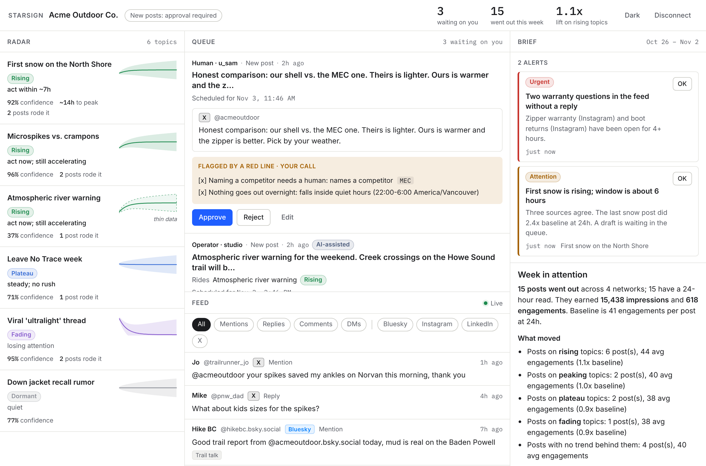

# base air

**The system of record for attention.** base air observes every surface where attention forms, forecasts where it is
going (with honest confidence bands), acts through operator agents inside the brand's declared red lines, and proves
what moved the outcome. It gets smarter with every brand on it.

- `docs/product-thesis.md` — what this is and why it wins (the five systems, the moat, the 24-month arc)
- `docs/social-command-center-plan.md` — platform API constraints, costs, build-vs-buy, roadmap
- `docs/API.md` — the HTTP contract the web room, the MCP server and agents build against



## Run it

```bash
pnpm install
pnpm seed            # demo workspace with a week of history; prints a sign-in (owner@acme.test + password) and two API keys
pnpm dev:api         # http://localhost:4000  (embedded PGlite at ./.pglite, in-process scheduler)
pnpm dev:web         # http://localhost:5173  sign in with the printed email and password
BASE_AIR_API_KEY=<agent key> pnpm dev:mcp     # stdio MCP server for Claude / ChatGPT
pnpm test            # 70+ tests, no network, embedded Postgres
pnpm typecheck
```

People sign in with email and password (sessions, teams with owner/approver/editor/viewer roles, invites, password
reset, and workspace switching for agencies running several brands). Until someone on a deployment has a password, the
app opens on "Create your account" and the first person to sign up becomes an owner (signing up with the email of an
existing passwordless user, such as the seed's, claims that user and its workspaces); after that it is invite-only unless
`BASE_AIR_ALLOW_SIGNUP=1`. Set `RESEND_API_KEY` and `MAIL_FROM` to email invites and reset links. API keys remain, for
agents and automation (the MCP server, operators, scripts); people no longer paste them.

Locked out and no mail configured? From a shell on the server (Render: the web service's Shell tab, which starts in
`apps/api`):

```bash
node --import tsx src/admin.ts users                  # who is on this deployment and who can sign in
node --import tsx src/admin.ts reset-link you@example.com   # one-time link, valid for an hour
```

Locally the same is `pnpm --filter @base-air/api admin users`.

Set `BASE_AIR_DEV_WORKSPACE=acme` to skip signing in locally. Set `DATABASE_URL` (Postgres + pgvector) and `REDIS_URL`
for durable queues; then run `pnpm dev:workers` and `pnpm dev:operators` as separate processes. `ANTHROPIC_API_KEY`
turns the operators' model calls on (`BASE_AIR_FAKE_AI=1` runs them with a fake gateway).

## Shape

```
packages/schema      the open event schema v0: networks, policy (red lines, autonomy), content, listening, measurement, trends, events
packages/policy      red-line evaluator + autonomy resolution + the single gate every post passes through
packages/forecast    deterministic trend engine: resample → kinematics → stage → damped Holt with residual bands
packages/db          Drizzle schema, SQL migration (append-only triggers, pgvector, optional Timescale), PGlite/Postgres client
packages/ledger      event store (raw + ledger, hash-deduped), outcome snapshot schedule (1h…30d), approval diffs
packages/connectors  Connector interface, per-network validation, mock, Bluesky (AT Protocol), X (v2), Zernio
packages/core        the services: workspaces, accounts, policy, posts, approvals, publishing, listening, metrics, trends, ops, export
packages/ai          model gateway (Claude) with versioned prompts and a fake for tests
packages/sources     trend sources: Google Trends (trending-now RSS + official alpha API), Wikipedia pageviews,
                     Hacker News, Bluesky search, YouTube trending; the brand's own feed is sampled in core
apps/api             Hono HTTP API + SSE, serves the web build, seed script
apps/workers         BullMQ: durable publish queue, ingest / outcomes / forecast schedules, metered-read caps
apps/operators       Scout (trending terms → new topics scored against the brand), Watch (forecast → alert → draft into
                     the queue), Analyst (weekly brief), Steward (semantic red lines)
apps/mcp             MCP server: agents see the radar, feed, ledger and red lines; their posts land in the approval queue
apps/web             the room: Radar · Queue · Feed · Brief on one screen, drawers for detail
```

Two spines run through everything. The **data spine**: two append-only logs (`raw_events`, `ledger_events`) the
database refuses to update or delete, and every other table a rebuildable derivation. The **policy spine**: one
`Policy` document per workspace (red lines, autonomy dial, spend caps, disclosure) consulted by the UI, the API, the
operators and the MCP server alike, through one function: `gatePost`.

## Principles (binding)

Estimates with confidence bands, never false precision. Every recommendation shows its evidence. Policy over buttons:
humans set red lines and autonomy, operators do the work, the ledger holds everyone accountable. One room, no
page-flipping. Honest about platforms. Provenance by default. Portable by design (`GET /v1/export`). Model-agnostic,
data-loyal.

## Deploy

`Dockerfile` builds one image; `render.yaml` runs it three ways (api, workers, operators) against Render Postgres 16
and Key Value, staging from `main`. Postgres needs the `vector` extension; TimescaleDB is used when present and skipped
when not.

## Review

`docs/REVIEW.md` records the adversarial review that ran over the codebase, what it found, what was fixed and what
was deliberately left. Invariants worth defending are listed in `docs/ARCHITECTURE.md`.

## Status

Phase 0 scaffold, built 2026-11-02. Native connectors post for real once credentials exist; platform reviews (Meta,
TikTok, LinkedIn pages) and the Google Trends alpha are external clocks — start them now.
